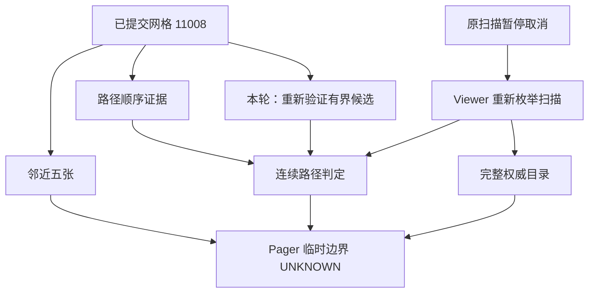

# 25 — Phase 1.5 Pixel 8 Pro 原始日志与源码审计

日期：2026-11-05。基线为重新读取的远程 HEAD `7670a10a3b857df490ea2120f6fa1272f48a8879`，没有重置历史提交。环境：Gallery 1.14.1 (32), Release, Pixel 8 Pro, Android 16/API 36, ALL_FILES。完整输入通过 `scripts/audit-phase15-device-logs.py` 逐行解析，原件保留在用户附件，不将真实媒体信息加入仓库。下面附全部事件计数和关键事件的非采样匿名转录。

## 1. 证据界限和关联键

F 为日志/源码事实；R 为源码支持但尚无设备因果证明的风险；U 为无法验证。

- `request` 是日志的请求 ID 字段，并非每行均有；媒体扫描另有 `businessRequest`、`scopeKey`、`sourceType`，Viewer 使用 `vw-*`。
- **不能**将 request=0 当成全局唯一请求。A 的新 Viewer 扫描和其他后台读取都可能为 0；B 的 worker `businessRequest=0` 与 Adapter request=11/12 没有直接相等关系。它们在源码调用链上有关联，但旧日志不能证明每条无 ID Performance 事件的归属。本轮把照片生产者 requestId 传入真实 business request，并增加单次 handoff ID + gridVersion 消费日志补足关联。
- `elapsedRealtimeMs` 为单调时间；墙钟仅帮助阅读。不同模块的 scopeKey 输入并不相同，不因为都为匿名 ID 就假定值相等。
- B 的 revision=0 只表示内容失效代际，**不表示**1070/3434/5285三份集合相同。原日志没有 commit 顺序版本。

## 2. A 时间线与源码入口

| 墙钟 | 单调 ms | request / source | 事实、数量、状态 | 源码入口 | 结论 |
|---|---:|---|---|---|---|
|12:44:10.412|689256393|business=1 / FOLDER|开始普通文件夹 worker|MediaActivity.startAsyncTask → GetMediaAsynctask|F|
|12:44:10.914|689256895|1 / FolderRefresh|缓存已 commit 11008，final=false|MediaActivity.publishMedia|F，原页面已有大集合候选，非完整授权凭据|
|12:44:14.369|689260350|无 request / Performance|viewer_catalog_miss|MediaActivity.openOrdinaryViewer|F，不能复用完整目录|
|12:44:14.384|689260365|1 / FolderRefresh|scan_cancelled|MediaActivity.onPause → stopFetching|F|
|12:44:14.390|689260372|ml-b8a15f61-b46b-4696-a879-463e91769b76 / FOLDER|business=1；scope=d18f41c17cca4435；CANCELLED；worker=3974ms；MediaStore=11348；metadata=786|GetMediaAsynctask.finishPipelineDiagnostics|F，11348是索引行数，不能声称全部完成磁盘验证|
|12:44:14.410|689260392|vw-b50714d0-8777-4c02-b059-4b9c940b0b31 / folder|scope=1df3c24ea48ded6c；选中 mediaId=22605a9e99edf2f7|ViewPagerActivity 入口|F|
|12:44:14.446|689260428|0 / FolderRefresh|新普通目录扫描开始|startFolderViewer.scanRemaining|F；request=0 有关联缺口|
|12:44:14.460|689260441|同上 vw|5张；position=2|publishAdjacent → gotMedia → refreshUI|F|
|12:44:14.906|689260887|同上 vw|index=1，mediaId=39fc7df98e397622|onPageSelected|F|
|12:44:15.231|689261212|同上 vw|index=0，mediaId=b5cbdf636c9ccefa|onPageSelected|F|
|12:44:15.710–19.189|689261691–689265170|无 request / Performance|10次 boundary_requested / wait，count=5|requestViewerBoundary|F；不能仅由10事件推断10个扫描|
|12:44:27.318|689273299|同上 vw|15张；position=1|publishFolderCandidates → gotMedia|F；比初始窗口迟12858ms|
|12:44:28.526|689274507|同上 vw|21张；position=1|同上|F|
|12:44:47.947|689293928|0 / FolderRefresh|记录结束，无 viewer_full_list_prepared|扫描尚未观察到正式完成|U，不能认定永久卡死|

原扫描：枚举 measure=2675ms，pipeline汇总=2677ms，两个口径边界不同；新枚举 measure=2597ms（单调端点差2596ms，有取整/采样边界）。使用各自原始值，不能混记。

### A 已确认的代码机制

1. `MediaActivity.openOrdinaryViewer` 只交接最多5个邻近 Medium 和路径顺序；完整 snapshot 仅在 displayedMediaIsFinal && !mIsGettingMedia 时可取。`onPause` 取消原 task。已有11008项缓存的候选元数据没有进入新的邻域验证链。
2. `GetMediaAsynctask` 新 task 重新索引/枚举。`MediaFetcher.getMediaInFolder` 按原始枚举顺序读取；Viewer 的 `ViewerGridOrderPolicy.contiguousPartial` 必须等待点击位置附近**连续**的已验证路径。扫描推进不等于点击位置的连续窗口推进，故可能长期保持5张。这是代码可重现的饥饿条件；不能证明日志中某个特定文件/线程池就是阻塞源。
3. 原 `scanRemaining` 用 AsyncTask 默认执行器，缺少 Viewer 自己的拒绝/取消/45秒 deadline 终态恢复。已存在请求代际、UNKNOWN、pending导航，不是“没有任何边界机制”。
4. 原普通 `gotMedia` 可以在手势延期 publication 尚未到 Pager 前把导航置 COMPLETE；该时序有提前 END 风险（R）。本轮在实际应用目录时转换。

共享评估：原 Activity 的回调关闭包持有 Activity、mediaScanGeneration、媒体缓存/目录写入和 UI 所有权；**不延长旧 Activity task 存活，也不整体删除 onPause 取消**。复用不可变的已提交候选元数据，Viewer 用自己的当前 session、revision、filter、文件状态重新验证；扫描仍单独归 Viewer 所有。保留一次重新扫描以保证完整性，不声称已经消除全部重复 IO。

## 3. B 时间线与问题分类

| 墙钟 | 单调 ms | request/source | 集合、目录、状态 | 入口 | 结论 |
|---|---:|---|---|---|---|
|12:46:51.254|689417235|11 / MediaUI|adapter_commit=1070|MediaAdapter.submitPendingUpdate|F，这才是实际显示集合|
|12:46:54.711|689420692|无 request / Performance|grid order handoff=1070|MediaActivity.openInViewPager|F|
|12:46:54.712|689420693|无 request / Performance|catalog lookup=3434|authenticateViewerRequest → Store.take/latest|F；不同阶段，非相同集合|
|12:46:54.739|689420720|vw-e91eede5-e32b-431c-a316-7d9f2ab4b9d9|scope=8ff622b815059511；首次1070，position1007|completePhotoViewerLoad|F|
|12:46:55.145–57.374|689421127–689423355|同上 vw|1006→1001；revision0；真实媒体ID见完整转录|onPageSelected|F|
|12:46:57.256|689423237|无 request / Performance|photo_catalog_ready=5285|PhotoSessionViewerCatalogStore.prepare|F；具体 worker 关联仅有调用链支持|
|12:46:57.581|689423563|ml-b4dfd76e-8d2c-4148-aea9-28c678541559 / PHOTO_PROFILE|scope=df3537849018704f；business0；COMPLETE；5285；worker8812ms|GetMediaAsynctask|F|
|12:46:57.764|689423745|同上 vw|目录5285，position1001|consumePhotoCatalogAdvance → gotMedia|F|
|12:46:59.086|689425067|11 / MediaUI|grid commit5285；old1070；diff1483ms|MediaAdapter|F，不能以更早的submit当作commit|
|12:47:55.997|689481979|同上 vw|关闭于index900；5285|onDestroy|F|
|12:48:02.845|689488827|ml-aa791b85-0006-467f-a80b-eabdd10e9c83 / PHOTO_PROFILE|同scope；business0；第二次COMPLETE；5285；worker7335ms|GetMediaAsynctask|F，不能与第一轮混合统计|
|12:48:07.519|689493500|12 / MediaUI|再次commit5285；diff68ms|MediaAdapter|F|

- **B1**：Viewer目录先于网格升级是F；具体用户指的照片是否为新增4215成员，日志没有网格完整匿名成员序列，**U**。最终范围可以增加合法新发现媒体，不能永远锁死1070。
- **B2**：`reconcile` 按旧gridOrder移除/排序再追加 remaining；完整日期排序可能变成“旧1070 + 其余4215”。这是F源码契约错误，已补确定性反例。保留旧顺序只适用于 partial 连续邻域和已开始的 random；COMPLETE 的非随机集合按生产者权威顺序，在 idle 应用并以当前 path 重定位。
- **B3**：没有 drawable 内容证据；`MyPagerAdapter` 按 path+type 管理 Fragment，Glide into 同一 target 替换请求、内容签名与 onDestroyView.clear 已存在。未证明异步B位图覆盖A，不改解码器/Glide，也不伪称完成B08的真实位图时序实验。

## 4. 性能、诊断与未证实项

第一轮同一 ml 请求摘要：metadataReadCount5285 / 6720ms；diskEnumerate808ms；MediaStore173ms；sortCount50 / sortMs99；worker8812ms。第二轮分别5285 / 5685ms，505ms、148ms、46 / 81ms、7335ms。无同条件修复后设备数据，不计算改善率/p50/p95。

B 全文件：40 adapter_submit、10 adapter_commit、14 diff_dropped、36 photo_grid_publication_replaced；跨两次请求的合计，**不是第一轮独有数**。stageCount47/45，而 stagePublishCount94/90，代码发现 loader 和 onProgressUpdate 对同一计数重复累加；本轮只保留生产者累加。该计数修正不能冒充减少了一半真实工作。

A 有10602对file_metadata_start/end=21204行；B有10570对=21140行。默认逐文件timing移除，原pipeline metadataReadCount/ms汇总和读失败/终态保留；异常传播不受影响。没有开关诊断的同设备A/B对照，日志性能影响为U。

未验证：死锁、永久不完成、某文件阻塞、线程池耗尽、具体照片位图错误、真实SAF撤权/外部覆盖、日志造成的百分比退化，均不得当成已确认根因。回归覆盖及缺口见26/27。

## 5. 完整输入解析附录

### 全屏后滑动了两张就卡住.txt

UTF-8 bytes=3634225；lines=21438；SHA-256 `df6fc09a1207791a817ab40c01ae17ddc637b8b103f072c58bcf6ee46dccb09d`。

完整逐行事件计数：

| Event | Count |
|---|---:|
| adapter_committed | 1 |
| album_adapter_commit | 1 |
| album_adapter_submit | 1 |
| album_identical_skip | 1 |
| album_index_ready | 1 |
| album_presentation_prepare | 1 |
| album_queued | 1 |
| directory_enumeration_end | 7 |
| directory_enumeration_start | 7 |
| directory_metadata_committed | 1 |
| favorite_relationships_end | 2 |
| favorite_relationships_start | 2 |
| file_metadata_end | 10602 |
| file_metadata_start | 10602 |
| folder_queued | 1 |
| media_cache_db_summary | 2 |
| media_load_terminal | 2 |
| media_scan_summary | 2 |
| media_sort_summary | 2 |
| media_source_summary | 2 |
| media_thumbnail_summary | 2 |
| media_ui_summary | 2 |
| media_viewer_publication | 3 |
| read_result | 4 |
| scan_cancelled | 1 |
| scan_output | 4 |
| scan_started | 2 |
| sorting_end | 61 |
| sorting_start | 61 |
| viewer_adjacent_image_rendered | 2 |
| viewer_adjacent_pager_ready | 1 |
| viewer_boundary_requested_folder | 10 |
| viewer_boundary_wait | 10 |
| viewer_catalog_miss | 1 |
| viewer_expand_started | 1 |
| viewer_fragment_created | 5 |
| viewer_fragment_destroyed | 2 |
| viewer_loading_shown | 1 |
| viewer_main_thread_publish | 3 |
| viewer_neighbors_validation | 1 |
| viewer_open | 1 |
| viewer_page_bound | 2 |
| viewer_pager_count | 1 |
| viewer_selected_image_rendered | 1 |
| viewer_selected_pager_ready | 1 |
| worker_started | 2 |

保留全部关键事件（非采样；没有 request 的事件不能按时间强行归属）：

| 原行 | 日志墙钟 | 单调 ms | request | event | 匿名字段 |
|---:|---|---:|---|---|---|
| 2201 | 2026-11-05 12:44:06.244 | 689252225 | ml-d2628503-a657-4b7f-bb4e-e2fe6c1fd0d2 | media_scan_summary | scopeKey=8d908973900ac10a sourceType=HOME businessRequest=3 terminalState=CANCELLED workerMs=-1 |
| 2203 | 2026-11-05 12:44:06.245 | 689252226 | ml-d2628503-a657-4b7f-bb4e-e2fe6c1fd0d2 | media_sort_summary | scopeKey=8d908973900ac10a sourceType=HOME businessRequest=3 sortCount=3 sortMs=3 sortMode=33800 |
| 2208 | 2026-11-05 12:44:06.246 | 689252227 | ml-d2628503-a657-4b7f-bb4e-e2fe6c1fd0d2 | media_source_summary | scopeKey=8d908973900ac10a sourceType=HOME businessRequest=3 metadataReadCount=399 metadataReadMs=416 mediaStoreRows=74318 diskEnumerateMs=105 |
| 2216 | 2026-11-05 12:44:06.247 | 689252228 | ml-d2628503-a657-4b7f-bb4e-e2fe6c1fd0d2 | media_ui_summary | scopeKey=8d908973900ac10a sourceType=HOME businessRequest=3 stageCount=-1 stagePublishCount=-1 diffMs=-1 |
| 2221 | 2026-11-05 12:44:06.248 | 689252229 | ml-d2628503-a657-4b7f-bb4e-e2fe6c1fd0d2 | media_load_terminal | scopeKey=8d908973900ac10a sourceType=HOME businessRequest=3 terminalState=CANCELLED |
| 7384 | 2026-11-05 12:44:10.412 | 689256393 | 1 | scan_started | count=0 |
| 7385 | 2026-11-05 12:44:10.414 | 689256395 | 1 | worker_started | count=0 |
| 7389 | 2026-11-05 12:44:10.914 | 689256895 | 1 | adapter_committed | count=11008 |
| 8951 | 2026-11-05 12:44:14.369 | 689260350 | 未提供 | viewer_catalog_miss | count=0 |
| 8963 | 2026-11-05 12:44:14.384 | 689260365 | 1 | scan_cancelled | count=0 |
| 8965 | 2026-11-05 12:44:14.390 | 689260372 | ml-b8a15f61-b46b-4696-a879-463e91769b76 | media_scan_summary | scopeKey=d18f41c17cca4435 sourceType=FOLDER businessRequest=1 terminalState=CANCELLED workerMs=3974 |
| 8966 | 2026-11-05 12:44:14.391 | 689260372 | ml-b8a15f61-b46b-4696-a879-463e91769b76 | media_sort_summary | scopeKey=d18f41c17cca4435 sourceType=FOLDER businessRequest=1 sortCount=-1 sortMs=-1 sortMode=-1 |
| 8967 | 2026-11-05 12:44:14.392 | 689260373 | ml-b8a15f61-b46b-4696-a879-463e91769b76 | media_source_summary | scopeKey=d18f41c17cca4435 sourceType=FOLDER businessRequest=1 metadataReadCount=786 metadataReadMs=1068 mediaStoreRows=11348 diskEnumerateMs=2677 |
| 8969 | 2026-11-05 12:44:14.392 | 689260374 | ml-b8a15f61-b46b-4696-a879-463e91769b76 | media_ui_summary | scopeKey=d18f41c17cca4435 sourceType=FOLDER businessRequest=1 stageCount=-1 stagePublishCount=-1 diffMs=-1 |
| 8971 | 2026-11-05 12:44:14.393 | 689260374 | ml-b8a15f61-b46b-4696-a879-463e91769b76 | media_load_terminal | scopeKey=d18f41c17cca4435 sourceType=FOLDER businessRequest=1 terminalState=CANCELLED |
| 8972 | 2026-11-05 12:44:14.410 | 689260392 | vw-b50714d0-8777-4c02-b059-4b9c940b0b31 | viewer_open | scopeKey=1df3c24ea48ded6c mediaId=22605a9e99edf2f7 |
| 8974 | 2026-11-05 12:44:14.446 | 689260428 | 0 | scan_started | count=0 |
| 8975 | 2026-11-05 12:44:14.447 | 689260428 | 0 | worker_started | count=0 |
| 8982 | 2026-11-05 12:44:14.460 | 689260441 | vw-b50714d0-8777-4c02-b059-4b9c940b0b31 | media_viewer_publication | scopeKey=1df3c24ea48ded6c itemCount=5 positionIndex=2 |
| 8990 | 2026-11-05 12:44:14.906 | 689260887 | vw-b50714d0-8777-4c02-b059-4b9c940b0b31 | viewer_page_bound | count=5 index=1 mediaId=39fc7df98e397622 revision=0 |
| 8993 | 2026-11-05 12:44:15.231 | 689261212 | vw-b50714d0-8777-4c02-b059-4b9c940b0b31 | viewer_page_bound | count=5 index=0 mediaId=b5cbdf636c9ccefa revision=0 |
| 8997 | 2026-11-05 12:44:15.710 | 689261691 | 未提供 | viewer_boundary_requested_folder | count=5 |
| 9000 | 2026-11-05 12:44:16.057 | 689262039 | 未提供 | viewer_boundary_requested_folder | count=5 |
| 9002 | 2026-11-05 12:44:16.481 | 689262462 | 未提供 | viewer_boundary_requested_folder | count=5 |
| 9004 | 2026-11-05 12:44:16.907 | 689262888 | 未提供 | viewer_boundary_requested_folder | count=5 |
| 9136 | 2026-11-05 12:44:17.271 | 689263252 | 未提供 | viewer_boundary_requested_folder | count=5 |
| 9590 | 2026-11-05 12:44:17.748 | 689263729 | 未提供 | viewer_boundary_requested_folder | count=5 |
| 9922 | 2026-11-05 12:44:18.084 | 689264065 | 未提供 | viewer_boundary_requested_folder | count=5 |
| 10236 | 2026-11-05 12:44:18.440 | 689264421 | 未提供 | viewer_boundary_requested_folder | count=5 |
| 10572 | 2026-11-05 12:44:18.833 | 689264814 | 未提供 | viewer_boundary_requested_folder | count=5 |
| 10803 | 2026-11-05 12:44:19.189 | 689265170 | 未提供 | viewer_boundary_requested_folder | count=5 |
| 20237 | 2026-11-05 12:44:27.318 | 689273299 | vw-b50714d0-8777-4c02-b059-4b9c940b0b31 | media_viewer_publication | scopeKey=1df3c24ea48ded6c itemCount=15 positionIndex=1 |
| 21401 | 2026-11-05 12:44:28.526 | 689274507 | vw-b50714d0-8777-4c02-b059-4b9c940b0b31 | media_viewer_publication | scopeKey=1df3c24ea48ded6c itemCount=21 positionIndex=1 |

### 出现于缩略图不符合的图片.txt

UTF-8 bytes=3809646；lines=22611；SHA-256 `d4a643431cfc08d6c56ef6f76b3854c6f41caf6c853482469700fb74bb314e64`。

完整逐行事件计数：

| Event | Count |
|---|---:|
| adapter_commit | 10 |
| adapter_committed | 11 |
| adapter_diff_dropped | 14 |
| adapter_submit | 40 |
| adapter_submit_replaced | 15 |
| directory_enumeration_end | 2 |
| directory_enumeration_start | 2 |
| file_metadata_end | 10570 |
| file_metadata_start | 10570 |
| media_cache_db_summary | 2 |
| media_load_terminal | 2 |
| media_scan_summary | 2 |
| media_sort_summary | 2 |
| media_source_summary | 2 |
| media_store_scoped | 2 |
| media_thumbnail_summary | 2 |
| media_ui_summary | 2 |
| media_viewer_publication | 2 |
| media_viewer_summary | 1 |
| photo_access | 216 |
| photo_cache | 1 |
| photo_catalog_ready | 2 |
| photo_first_frame | 2 |
| photo_grid_main_publish | 41 |
| photo_grid_publication_deferred | 3 |
| photo_grid_publication_replaced | 36 |
| photo_index_query | 2 |
| photo_return_source_check | 1 |
| photo_sort | 3 |
| photo_supplement_scan | 2 |
| scan_cancelled | 5 |
| scan_completed | 2 |
| scan_output | 2 |
| scan_partial_published | 3 |
| scan_started | 2 |
| sorting_end | 96 |
| sorting_start | 96 |
| viewer_adapter_publish | 1 |
| viewer_catalog_deferred_during_swipe | 1 |
| viewer_catalog_freshness | 2 |
| viewer_catalog_hit | 2 |
| viewer_catalog_lookup | 1 |
| viewer_catalog_miss | 4 |
| viewer_catalog_upgrade | 12 |
| viewer_close | 1 |
| viewer_fragment_created | 118 |
| viewer_fragment_destroyed | 113 |
| viewer_full_list_ready | 1 |
| viewer_grid_order_handoff | 1 |
| viewer_handoff_result | 1 |
| viewer_handoff_result_ready | 1 |
| viewer_initial_catalog | 1 |
| viewer_main_thread_publish | 2 |
| viewer_open | 1 |
| viewer_page_access_cache_hit | 233 |
| viewer_page_access_cache_miss | 108 |
| viewer_page_bound | 113 |
| viewer_page_window_validation | 108 |
| viewer_pager_count | 2 |
| viewer_selected_image_rendered | 1 |
| viewer_selected_pager_ready | 1 |
| worker_started | 2 |

保留全部关键事件（非采样；没有 request 的事件不能按时间强行归属）：

| 原行 | 日志墙钟 | 单调 ms | request | event | 匿名字段 |
|---:|---|---:|---|---|---|
| 13 | 2026-11-05 12:46:48.763 | 689414744 | 0 | scan_cancelled | count=0 |
| 14 | 2026-11-05 12:46:48.771 | 689414752 | 0 | scan_started | count=0 |
| 15 | 2026-11-05 12:46:48.777 | 689414758 | 0 | worker_started | count=0 |
| 16 | 2026-11-05 12:46:48.785 | 689414766 | 未提供 | viewer_catalog_miss | count=0 |
| 22 | 2026-11-05 12:46:48.832 | 689414813 | 11 | adapter_committed | count=160 |
| 271 | 2026-11-05 12:46:50.045 | 689416026 | 11 | adapter_commit | itemCount=263 diffMs=5 |
| 273 | 2026-11-05 12:46:50.045 | 689416026 | 11 | adapter_committed | count=263 |
| 470 | 2026-11-05 12:46:50.249 | 689416230 | 11 | adapter_commit | itemCount=365 diffMs=5 |
| 471 | 2026-11-05 12:46:50.249 | 689416231 | 11 | adapter_committed | count=365 |
| 732 | 2026-11-05 12:46:50.455 | 689416437 | 11 | adapter_commit | itemCount=470 diffMs=16 |
| 735 | 2026-11-05 12:46:50.456 | 689416437 | 11 | adapter_committed | count=470 |
| 953 | 2026-11-05 12:46:50.576 | 689416557 | 11 | adapter_commit | itemCount=590 diffMs=7 |
| 954 | 2026-11-05 12:46:50.577 | 689416558 | 11 | adapter_committed | count=590 |
| 1218 | 2026-11-05 12:46:50.746 | 689416727 | 11 | adapter_commit | itemCount=710 diffMs=10 |
| 1219 | 2026-11-05 12:46:50.746 | 689416727 | 11 | adapter_committed | count=710 |
| 1465 | 2026-11-05 12:46:50.928 | 689416909 | 11 | adapter_commit | itemCount=830 diffMs=13 |
| 1467 | 2026-11-05 12:46:50.929 | 689416910 | 11 | adapter_committed | count=830 |
| 1694 | 2026-11-05 12:46:51.053 | 689417034 | 11 | adapter_commit | itemCount=950 diffMs=5 |
| 1695 | 2026-11-05 12:46:51.053 | 689417035 | 11 | adapter_committed | count=950 |
| 1936 | 2026-11-05 12:46:51.254 | 689417235 | 11 | adapter_commit | itemCount=1070 diffMs=9 |
| 1938 | 2026-11-05 12:46:51.255 | 689417236 | 11 | adapter_committed | count=1070 |
| 6867 | 2026-11-05 12:46:54.695 | 689420676 | vw-e91eede5-e32b-431c-a316-7d9f2ab4b9d9 | viewer_open | scopeKey=8ff622b815059511 mediaId=22605a9e99edf2f7 |
| 6908 | 2026-11-05 12:46:54.711 | 689420692 | 未提供 | viewer_grid_order_handoff | count=1070 |
| 6909 | 2026-11-05 12:46:54.712 | 689420693 | 未提供 | viewer_catalog_lookup | count=3434 |
| 6971 | 2026-11-05 12:46:54.739 | 689420720 | vw-e91eede5-e32b-431c-a316-7d9f2ab4b9d9 | media_viewer_publication | scopeKey=8ff622b815059511 itemCount=1070 positionIndex=1007 |
| 6997 | 2026-11-05 12:46:54.754 | 689420735 | 未提供 | viewer_catalog_upgrade | count=1070 |
| 7052 | 2026-11-05 12:46:54.827 | 689420809 | 未提供 | viewer_catalog_upgrade | count=1070 |
| 7265 | 2026-11-05 12:46:55.037 | 689421018 | 未提供 | viewer_catalog_upgrade | count=1070 |
| 7407 | 2026-11-05 12:46:55.145 | 689421127 | vw-e91eede5-e32b-431c-a316-7d9f2ab4b9d9 | viewer_page_bound | count=1070 index=1006 mediaId=5d7dfc0f7a0060f8 revision=0 |
| 7854 | 2026-11-05 12:46:55.444 | 689421426 | vw-e91eede5-e32b-431c-a316-7d9f2ab4b9d9 | viewer_page_bound | count=1070 index=1005 mediaId=6e36cd7e419fbc1a revision=0 |
| 8431 | 2026-11-05 12:46:55.797 | 689421778 | 未提供 | viewer_catalog_upgrade | count=1070 |
| 8512 | 2026-11-05 12:46:55.843 | 689421825 | 未提供 | viewer_catalog_upgrade | count=1070 |
| 8712 | 2026-11-05 12:46:55.941 | 689421922 | 未提供 | viewer_catalog_upgrade | count=1070 |
| 9002 | 2026-11-05 12:46:56.054 | 689422035 | 未提供 | viewer_catalog_upgrade | count=1070 |
| 9280 | 2026-11-05 12:46:56.178 | 689422159 | 未提供 | viewer_catalog_upgrade | count=1070 |
| 9326 | 2026-11-05 12:46:56.205 | 689422186 | vw-e91eede5-e32b-431c-a316-7d9f2ab4b9d9 | viewer_page_bound | count=1070 index=1004 mediaId=8543671cbf573a45 revision=0 |
| 9827 | 2026-11-05 12:46:56.512 | 689422493 | vw-e91eede5-e32b-431c-a316-7d9f2ab4b9d9 | viewer_page_bound | count=1070 index=1003 mediaId=fb6b80f6e01c2c03 revision=0 |
| 10520 | 2026-11-05 12:46:56.898 | 689422879 | 未提供 | viewer_catalog_upgrade | count=1070 |
| 10748 | 2026-11-05 12:46:57.046 | 689423027 | 未提供 | viewer_catalog_upgrade | count=1070 |
| 10799 | 2026-11-05 12:46:57.074 | 689423055 | vw-e91eede5-e32b-431c-a316-7d9f2ab4b9d9 | viewer_page_bound | count=1070 index=1002 mediaId=1957cd01fbc842e5 revision=0 |
| 10921 | 2026-11-05 12:46:57.203 | 689423185 | 未提供 | viewer_catalog_miss | count=5285 |
| 10922 | 2026-11-05 12:46:57.256 | 689423237 | 未提供 | photo_catalog_ready | count=5285 |
| 10928 | 2026-11-05 12:46:57.345 | 689423326 | 未提供 | viewer_catalog_upgrade | count=5285 |
| 10933 | 2026-11-05 12:46:57.374 | 689423355 | vw-e91eede5-e32b-431c-a316-7d9f2ab4b9d9 | viewer_page_bound | count=1070 index=1001 mediaId=1f3430cdb6562319 revision=0 |
| 10935 | 2026-11-05 12:46:57.581 | 689423563 | ml-b4dfd76e-8d2c-4148-aea9-28c678541559 | media_scan_summary | scopeKey=df3537849018704f sourceType=PHOTO_PROFILE businessRequest=0 terminalState=COMPLETE workerMs=8812 |
| 10936 | 2026-11-05 12:46:57.583 | 689423564 | ml-b4dfd76e-8d2c-4148-aea9-28c678541559 | media_sort_summary | scopeKey=df3537849018704f sourceType=PHOTO_PROFILE businessRequest=0 sortCount=50 sortMs=99 sortMode=1026 |
| 10937 | 2026-11-05 12:46:57.584 | 689423565 | ml-b4dfd76e-8d2c-4148-aea9-28c678541559 | media_source_summary | scopeKey=df3537849018704f sourceType=PHOTO_PROFILE businessRequest=0 metadataReadCount=5285 metadataReadMs=6720 mediaStoreRows=5285 diskEnumerateMs=808 |
| 10939 | 2026-11-05 12:46:57.587 | 689423568 | ml-b4dfd76e-8d2c-4148-aea9-28c678541559 | media_ui_summary | scopeKey=df3537849018704f sourceType=PHOTO_PROFILE businessRequest=0 stageCount=47 stagePublishCount=94 diffMs=-1 |
| 10941 | 2026-11-05 12:46:57.589 | 689423570 | ml-b4dfd76e-8d2c-4148-aea9-28c678541559 | media_load_terminal | scopeKey=df3537849018704f sourceType=PHOTO_PROFILE businessRequest=0 terminalState=COMPLETE |
| 10947 | 2026-11-05 12:46:57.764 | 689423745 | vw-e91eede5-e32b-431c-a316-7d9f2ab4b9d9 | media_viewer_publication | scopeKey=8ff622b815059511 itemCount=5285 positionIndex=1001 |
| 10950 | 2026-11-05 12:46:57.775 | 689423756 | 未提供 | viewer_full_list_ready | count=5285 |
| 10955 | 2026-11-05 12:46:57.797 | 689423778 | 未提供 | viewer_catalog_upgrade | count=5285 |
| 10961 | 2026-11-05 12:46:57.989 | 689423970 | vw-e91eede5-e32b-431c-a316-7d9f2ab4b9d9 | viewer_page_bound | count=5285 index=1000 mediaId=8dba063f5dec93b6 revision=0 |
| 10966 | 2026-11-05 12:46:58.260 | 689424241 | vw-e91eede5-e32b-431c-a316-7d9f2ab4b9d9 | viewer_page_bound | count=5285 index=999 mediaId=6ed91649b0b976c4 revision=0 |
| 10977 | 2026-11-05 12:46:58.845 | 689424826 | vw-e91eede5-e32b-431c-a316-7d9f2ab4b9d9 | viewer_page_bound | count=5285 index=998 mediaId=488f65526d6f246d revision=0 |
| 10984 | 2026-11-05 12:46:59.086 | 689425067 | 11 | adapter_commit | itemCount=5285 diffMs=1483 |
| 10985 | 2026-11-05 12:46:59.087 | 689425068 | 11 | adapter_committed | count=5285 |
| 10987 | 2026-11-05 12:46:59.107 | 689425088 | vw-e91eede5-e32b-431c-a316-7d9f2ab4b9d9 | viewer_page_bound | count=5285 index=997 mediaId=ef823bda49b30f83 revision=0 |
| 10995 | 2026-11-05 12:46:59.696 | 689425677 | vw-e91eede5-e32b-431c-a316-7d9f2ab4b9d9 | viewer_page_bound | count=5285 index=996 mediaId=019926dcc07dc8ef revision=0 |
| 11003 | 2026-11-05 12:46:59.979 | 689425960 | vw-e91eede5-e32b-431c-a316-7d9f2ab4b9d9 | viewer_page_bound | count=5285 index=995 mediaId=09fc43fd88fed8d4 revision=0 |
| 11011 | 2026-11-05 12:47:00.561 | 689426542 | vw-e91eede5-e32b-431c-a316-7d9f2ab4b9d9 | viewer_page_bound | count=5285 index=994 mediaId=00d7637e78202ebf revision=0 |
| 11019 | 2026-11-05 12:47:00.839 | 689426821 | vw-e91eede5-e32b-431c-a316-7d9f2ab4b9d9 | viewer_page_bound | count=5285 index=993 mediaId=6ef4742b0765062c revision=0 |
| 11024 | 2026-11-05 12:47:01.431 | 689427413 | vw-e91eede5-e32b-431c-a316-7d9f2ab4b9d9 | viewer_page_bound | count=5285 index=992 mediaId=f4a2b2ead1ee0b82 revision=0 |
| 11035 | 2026-11-05 12:47:01.721 | 689427703 | vw-e91eede5-e32b-431c-a316-7d9f2ab4b9d9 | viewer_page_bound | count=5285 index=991 mediaId=0ed6994254db285d revision=0 |
| 11043 | 2026-11-05 12:47:02.211 | 689428192 | vw-e91eede5-e32b-431c-a316-7d9f2ab4b9d9 | viewer_page_bound | count=5285 index=990 mediaId=05707c83678114fe revision=0 |
| 11051 | 2026-11-05 12:47:02.480 | 689428462 | vw-e91eede5-e32b-431c-a316-7d9f2ab4b9d9 | viewer_page_bound | count=5285 index=989 mediaId=4d5a47ae6f590566 revision=0 |
| 11057 | 2026-11-05 12:47:02.980 | 689428961 | vw-e91eede5-e32b-431c-a316-7d9f2ab4b9d9 | viewer_page_bound | count=5285 index=988 mediaId=c0ffb9d0ce1b6ce8 revision=0 |
| 11066 | 2026-11-05 12:47:03.243 | 689429224 | vw-e91eede5-e32b-431c-a316-7d9f2ab4b9d9 | viewer_page_bound | count=5285 index=987 mediaId=4abb358f04ef0260 revision=0 |
| 11074 | 2026-11-05 12:47:03.706 | 689429687 | vw-e91eede5-e32b-431c-a316-7d9f2ab4b9d9 | viewer_page_bound | count=5285 index=986 mediaId=d2d4e870322fffbb revision=0 |
| 11082 | 2026-11-05 12:47:04.010 | 689429991 | vw-e91eede5-e32b-431c-a316-7d9f2ab4b9d9 | viewer_page_bound | count=5285 index=985 mediaId=a7cb303ff91255e9 revision=0 |
| 11089 | 2026-11-05 12:47:04.373 | 689430354 | vw-e91eede5-e32b-431c-a316-7d9f2ab4b9d9 | viewer_page_bound | count=5285 index=984 mediaId=621cd92d1d4212c0 revision=0 |
| 11097 | 2026-11-05 12:47:04.660 | 689430641 | vw-e91eede5-e32b-431c-a316-7d9f2ab4b9d9 | viewer_page_bound | count=5285 index=983 mediaId=16915589e983cba7 revision=0 |
| 11105 | 2026-11-05 12:47:05.044 | 689431025 | vw-e91eede5-e32b-431c-a316-7d9f2ab4b9d9 | viewer_page_bound | count=5285 index=982 mediaId=051c4f064ebe6369 revision=0 |
| 11110 | 2026-11-05 12:47:05.300 | 689431282 | vw-e91eede5-e32b-431c-a316-7d9f2ab4b9d9 | viewer_page_bound | count=5285 index=981 mediaId=d201e37ecf6f5ff1 revision=0 |
| 11121 | 2026-11-05 12:47:05.742 | 689431724 | vw-e91eede5-e32b-431c-a316-7d9f2ab4b9d9 | viewer_page_bound | count=5285 index=980 mediaId=48ae70c8622e3752 revision=0 |
| 11125 | 2026-11-05 12:47:05.997 | 689431978 | vw-e91eede5-e32b-431c-a316-7d9f2ab4b9d9 | viewer_page_bound | count=5285 index=979 mediaId=0c5b60853e649187 revision=0 |
| 11136 | 2026-11-05 12:47:06.514 | 689432496 | vw-e91eede5-e32b-431c-a316-7d9f2ab4b9d9 | viewer_page_bound | count=5285 index=978 mediaId=9e68e9faa36e459c revision=0 |
| 11144 | 2026-11-05 12:47:06.775 | 689432756 | vw-e91eede5-e32b-431c-a316-7d9f2ab4b9d9 | viewer_page_bound | count=5285 index=977 mediaId=8a67a2290bec0d2f revision=0 |
| 11152 | 2026-11-05 12:47:07.243 | 689433224 | vw-e91eede5-e32b-431c-a316-7d9f2ab4b9d9 | viewer_page_bound | count=5285 index=976 mediaId=7a6e61c810535a3a revision=0 |
| 11160 | 2026-11-05 12:47:07.512 | 689433494 | vw-e91eede5-e32b-431c-a316-7d9f2ab4b9d9 | viewer_page_bound | count=5285 index=975 mediaId=04c69067d7f136a7 revision=0 |
| 11168 | 2026-11-05 12:47:08.039 | 689434020 | vw-e91eede5-e32b-431c-a316-7d9f2ab4b9d9 | viewer_page_bound | count=5285 index=974 mediaId=a381a27b5882c0a6 revision=0 |
| 11173 | 2026-11-05 12:47:08.309 | 689434291 | vw-e91eede5-e32b-431c-a316-7d9f2ab4b9d9 | viewer_page_bound | count=5285 index=973 mediaId=3ecdefad881eaa44 revision=0 |
| 11184 | 2026-11-05 12:47:08.779 | 689434761 | vw-e91eede5-e32b-431c-a316-7d9f2ab4b9d9 | viewer_page_bound | count=5285 index=972 mediaId=35b2155c2174538c revision=0 |
| 11192 | 2026-11-05 12:47:09.065 | 689435047 | vw-e91eede5-e32b-431c-a316-7d9f2ab4b9d9 | viewer_page_bound | count=5285 index=971 mediaId=4ed4e4c0397a3737 revision=0 |
| 11200 | 2026-11-05 12:47:09.556 | 689435538 | vw-e91eede5-e32b-431c-a316-7d9f2ab4b9d9 | viewer_page_bound | count=5285 index=970 mediaId=33fa9d334289471e revision=0 |
| 11208 | 2026-11-05 12:47:09.839 | 689435820 | vw-e91eede5-e32b-431c-a316-7d9f2ab4b9d9 | viewer_page_bound | count=5285 index=969 mediaId=2bd90a2e7a4245c7 revision=0 |
| 11216 | 2026-11-05 12:47:10.309 | 689436290 | vw-e91eede5-e32b-431c-a316-7d9f2ab4b9d9 | viewer_page_bound | count=5285 index=968 mediaId=4b279b44547a3378 revision=0 |
| 11224 | 2026-11-05 12:47:10.568 | 689436549 | vw-e91eede5-e32b-431c-a316-7d9f2ab4b9d9 | viewer_page_bound | count=5285 index=967 mediaId=56b4805208661b22 revision=0 |
| 11232 | 2026-11-05 12:47:11.113 | 689437095 | vw-e91eede5-e32b-431c-a316-7d9f2ab4b9d9 | viewer_page_bound | count=5285 index=966 mediaId=66ab3af91451f969 revision=0 |
| 11240 | 2026-11-05 12:47:11.369 | 689437350 | vw-e91eede5-e32b-431c-a316-7d9f2ab4b9d9 | viewer_page_bound | count=5285 index=965 mediaId=32ce36d9a6382364 revision=0 |
| 11248 | 2026-11-05 12:47:11.890 | 689437871 | vw-e91eede5-e32b-431c-a316-7d9f2ab4b9d9 | viewer_page_bound | count=5285 index=964 mediaId=3025ec121cef0279 revision=0 |
| 11256 | 2026-11-05 12:47:12.159 | 689438141 | vw-e91eede5-e32b-431c-a316-7d9f2ab4b9d9 | viewer_page_bound | count=5285 index=963 mediaId=d16fb4420ba4e175 revision=0 |
| 11264 | 2026-11-05 12:47:12.658 | 689438639 | vw-e91eede5-e32b-431c-a316-7d9f2ab4b9d9 | viewer_page_bound | count=5285 index=962 mediaId=af78306fc6078510 revision=0 |
| 11272 | 2026-11-05 12:47:12.937 | 689438918 | vw-e91eede5-e32b-431c-a316-7d9f2ab4b9d9 | viewer_page_bound | count=5285 index=961 mediaId=1b8a67b95137af34 revision=0 |
| 11277 | 2026-11-05 12:47:13.435 | 689439416 | vw-e91eede5-e32b-431c-a316-7d9f2ab4b9d9 | viewer_page_bound | count=5285 index=960 mediaId=65abbd3eadf98b0b revision=0 |
| 11287 | 2026-11-05 12:47:13.709 | 689439690 | vw-e91eede5-e32b-431c-a316-7d9f2ab4b9d9 | viewer_page_bound | count=5285 index=959 mediaId=fb2ff8882467892e revision=0 |
| 11292 | 2026-11-05 12:47:14.197 | 689440179 | vw-e91eede5-e32b-431c-a316-7d9f2ab4b9d9 | viewer_page_bound | count=5285 index=958 mediaId=eb6e1df53e258629 revision=0 |
| 11300 | 2026-11-05 12:47:14.418 | 689440399 | vw-e91eede5-e32b-431c-a316-7d9f2ab4b9d9 | viewer_page_bound | count=5285 index=957 mediaId=f04cd598fa654ed3 revision=0 |
| 11311 | 2026-11-05 12:47:15.000 | 689440981 | vw-e91eede5-e32b-431c-a316-7d9f2ab4b9d9 | viewer_page_bound | count=5285 index=956 mediaId=c985629c46671e43 revision=0 |
| 11319 | 2026-11-05 12:47:15.258 | 689441239 | vw-e91eede5-e32b-431c-a316-7d9f2ab4b9d9 | viewer_page_bound | count=5285 index=955 mediaId=7824152e519cff78 revision=0 |
| 11327 | 2026-11-05 12:47:15.781 | 689441762 | vw-e91eede5-e32b-431c-a316-7d9f2ab4b9d9 | viewer_page_bound | count=5285 index=954 mediaId=b8c125a1d7c209e7 revision=0 |
| 11334 | 2026-11-05 12:47:16.068 | 689442049 | vw-e91eede5-e32b-431c-a316-7d9f2ab4b9d9 | viewer_page_bound | count=5285 index=953 mediaId=c8bfa1aac034ae43 revision=0 |
| 11342 | 2026-11-05 12:47:16.641 | 689442623 | vw-e91eede5-e32b-431c-a316-7d9f2ab4b9d9 | viewer_page_bound | count=5285 index=952 mediaId=7aeccf140905fb79 revision=0 |
| 11350 | 2026-11-05 12:47:16.935 | 689442916 | vw-e91eede5-e32b-431c-a316-7d9f2ab4b9d9 | viewer_page_bound | count=5285 index=951 mediaId=73d48029cf080c00 revision=0 |
| 11358 | 2026-11-05 12:47:17.521 | 689443502 | vw-e91eede5-e32b-431c-a316-7d9f2ab4b9d9 | viewer_page_bound | count=5285 index=950 mediaId=b270c974f2eefd57 revision=0 |
| 11366 | 2026-11-05 12:47:17.802 | 689443784 | vw-e91eede5-e32b-431c-a316-7d9f2ab4b9d9 | viewer_page_bound | count=5285 index=949 mediaId=3d0462b6d94de4c1 revision=0 |
| 11372 | 2026-11-05 12:47:18.812 | 689444793 | vw-e91eede5-e32b-431c-a316-7d9f2ab4b9d9 | viewer_page_bound | count=5285 index=948 mediaId=361fceac66ed2b76 revision=0 |
| 11383 | 2026-11-05 12:47:19.116 | 689445098 | vw-e91eede5-e32b-431c-a316-7d9f2ab4b9d9 | viewer_page_bound | count=5285 index=947 mediaId=8a4f7d08facd885c revision=0 |
| 11388 | 2026-11-05 12:47:19.712 | 689445693 | vw-e91eede5-e32b-431c-a316-7d9f2ab4b9d9 | viewer_page_bound | count=5285 index=946 mediaId=7f1ee095d2c5c138 revision=0 |
| 11398 | 2026-11-05 12:47:20.035 | 689446016 | vw-e91eede5-e32b-431c-a316-7d9f2ab4b9d9 | viewer_page_bound | count=5285 index=945 mediaId=6a5ef0ccca8a59aa revision=0 |
| 11403 | 2026-11-05 12:47:20.479 | 689446460 | vw-e91eede5-e32b-431c-a316-7d9f2ab4b9d9 | viewer_page_bound | count=5285 index=944 mediaId=794d020db380eb17 revision=0 |
| 11414 | 2026-11-05 12:47:20.734 | 689446715 | vw-e91eede5-e32b-431c-a316-7d9f2ab4b9d9 | viewer_page_bound | count=5285 index=943 mediaId=5ebc1e364196e782 revision=0 |
| 11422 | 2026-11-05 12:47:21.249 | 689447231 | vw-e91eede5-e32b-431c-a316-7d9f2ab4b9d9 | viewer_page_bound | count=5285 index=942 mediaId=aea497600358e200 revision=0 |
| 11430 | 2026-11-05 12:47:21.521 | 689447502 | vw-e91eede5-e32b-431c-a316-7d9f2ab4b9d9 | viewer_page_bound | count=5285 index=941 mediaId=0a240378dad38e41 revision=0 |
| 11436 | 2026-11-05 12:47:21.974 | 689447955 | vw-e91eede5-e32b-431c-a316-7d9f2ab4b9d9 | viewer_page_bound | count=5285 index=940 mediaId=e443680b913cca8d revision=0 |
| 11445 | 2026-11-05 12:47:22.243 | 689448225 | vw-e91eede5-e32b-431c-a316-7d9f2ab4b9d9 | viewer_page_bound | count=5285 index=939 mediaId=a41159b47df7abdc revision=0 |
| 11453 | 2026-11-05 12:47:22.804 | 689448786 | vw-e91eede5-e32b-431c-a316-7d9f2ab4b9d9 | viewer_page_bound | count=5285 index=938 mediaId=d498a94788bf026d revision=0 |
| 11461 | 2026-11-05 12:47:23.069 | 689449051 | vw-e91eede5-e32b-431c-a316-7d9f2ab4b9d9 | viewer_page_bound | count=5285 index=937 mediaId=3c2d5f05ecabc227 revision=0 |
| 11469 | 2026-11-05 12:47:23.575 | 689449556 | vw-e91eede5-e32b-431c-a316-7d9f2ab4b9d9 | viewer_page_bound | count=5285 index=936 mediaId=87237b2d2543339c revision=0 |
| 11477 | 2026-11-05 12:47:23.841 | 689449823 | vw-e91eede5-e32b-431c-a316-7d9f2ab4b9d9 | viewer_page_bound | count=5285 index=935 mediaId=bf94a9020eb0dc81 revision=0 |
| 11485 | 2026-11-05 12:47:24.388 | 689450369 | vw-e91eede5-e32b-431c-a316-7d9f2ab4b9d9 | viewer_page_bound | count=5285 index=934 mediaId=5f6acfea3f05324c revision=0 |
| 11493 | 2026-11-05 12:47:24.681 | 689450663 | vw-e91eede5-e32b-431c-a316-7d9f2ab4b9d9 | viewer_page_bound | count=5285 index=933 mediaId=70761e563aa692f1 revision=0 |
| 11501 | 2026-11-05 12:47:25.152 | 689451134 | vw-e91eede5-e32b-431c-a316-7d9f2ab4b9d9 | viewer_page_bound | count=5285 index=932 mediaId=db2a460d6ddaff6e revision=0 |
| 11509 | 2026-11-05 12:47:25.420 | 689451401 | vw-e91eede5-e32b-431c-a316-7d9f2ab4b9d9 | viewer_page_bound | count=5285 index=931 mediaId=672316a0a887da59 revision=0 |
| 11517 | 2026-11-05 12:47:25.965 | 689451947 | vw-e91eede5-e32b-431c-a316-7d9f2ab4b9d9 | viewer_page_bound | count=5285 index=930 mediaId=b67481aee24c6e59 revision=0 |
| 11525 | 2026-11-05 12:47:26.260 | 689452241 | vw-e91eede5-e32b-431c-a316-7d9f2ab4b9d9 | viewer_page_bound | count=5285 index=929 mediaId=cba0236093987f5e revision=0 |
| 11533 | 2026-11-05 12:47:26.751 | 689452733 | vw-e91eede5-e32b-431c-a316-7d9f2ab4b9d9 | viewer_page_bound | count=5285 index=928 mediaId=92673f6f3e6603f6 revision=0 |
| 11541 | 2026-11-05 12:47:27.055 | 689453036 | vw-e91eede5-e32b-431c-a316-7d9f2ab4b9d9 | viewer_page_bound | count=5285 index=927 mediaId=dfe1d957224c3510 revision=0 |
| 11547 | 2026-11-05 12:47:27.539 | 689453520 | vw-e91eede5-e32b-431c-a316-7d9f2ab4b9d9 | viewer_page_bound | count=5285 index=926 mediaId=b174f48280af4de8 revision=0 |
| 11556 | 2026-11-05 12:47:27.809 | 689453790 | vw-e91eede5-e32b-431c-a316-7d9f2ab4b9d9 | viewer_page_bound | count=5285 index=925 mediaId=b11c0bd504fa4665 revision=0 |
| 11564 | 2026-11-05 12:47:28.311 | 689454292 | vw-e91eede5-e32b-431c-a316-7d9f2ab4b9d9 | viewer_page_bound | count=5285 index=924 mediaId=40464747fb6272ef revision=0 |
| 11572 | 2026-11-05 12:47:28.627 | 689454609 | vw-e91eede5-e32b-431c-a316-7d9f2ab4b9d9 | viewer_page_bound | count=5285 index=923 mediaId=c03297734cee166c revision=0 |
| 11580 | 2026-11-05 12:47:29.146 | 689455127 | vw-e91eede5-e32b-431c-a316-7d9f2ab4b9d9 | viewer_page_bound | count=5285 index=922 mediaId=3aa78ac91c8b2dca revision=0 |
| 11588 | 2026-11-05 12:47:29.439 | 689455420 | vw-e91eede5-e32b-431c-a316-7d9f2ab4b9d9 | viewer_page_bound | count=5285 index=921 mediaId=def99c54819b6929 revision=0 |
| 11594 | 2026-11-05 12:47:30.032 | 689456013 | vw-e91eede5-e32b-431c-a316-7d9f2ab4b9d9 | viewer_page_bound | count=5285 index=922 mediaId=3aa78ac91c8b2dca revision=0 |
| 11600 | 2026-11-05 12:47:30.328 | 689456309 | vw-e91eede5-e32b-431c-a316-7d9f2ab4b9d9 | viewer_page_bound | count=5285 index=923 mediaId=c03297734cee166c revision=0 |
| 11606 | 2026-11-05 12:47:34.594 | 689460576 | vw-e91eede5-e32b-431c-a316-7d9f2ab4b9d9 | viewer_page_bound | count=5285 index=922 mediaId=3aa78ac91c8b2dca revision=0 |
| 11611 | 2026-11-05 12:47:34.875 | 689460856 | vw-e91eede5-e32b-431c-a316-7d9f2ab4b9d9 | viewer_page_bound | count=5285 index=921 mediaId=def99c54819b6929 revision=0 |
| 11619 | 2026-11-05 12:47:35.190 | 689461171 | vw-e91eede5-e32b-431c-a316-7d9f2ab4b9d9 | viewer_page_bound | count=5285 index=920 mediaId=93acbd1114f9d1a8 revision=0 |
| 11625 | 2026-11-05 12:47:35.455 | 689461436 | vw-e91eede5-e32b-431c-a316-7d9f2ab4b9d9 | viewer_page_bound | count=5285 index=919 mediaId=16263cc2ecd92c9f revision=0 |
| 11632 | 2026-11-05 12:47:35.830 | 689461811 | vw-e91eede5-e32b-431c-a316-7d9f2ab4b9d9 | viewer_page_bound | count=5285 index=918 mediaId=7d5fa01ccb9c59de revision=0 |
| 11642 | 2026-11-05 12:47:36.107 | 689462088 | vw-e91eede5-e32b-431c-a316-7d9f2ab4b9d9 | viewer_page_bound | count=5285 index=917 mediaId=f7f9c5fdf5d24998 revision=0 |
| 11650 | 2026-11-05 12:47:36.519 | 689462500 | vw-e91eede5-e32b-431c-a316-7d9f2ab4b9d9 | viewer_page_bound | count=5285 index=916 mediaId=6007b43ebb201f33 revision=0 |
| 11657 | 2026-11-05 12:47:36.799 | 689462780 | vw-e91eede5-e32b-431c-a316-7d9f2ab4b9d9 | viewer_page_bound | count=5285 index=915 mediaId=487c9eb592496d4f revision=0 |
| 11665 | 2026-11-05 12:47:37.243 | 689463224 | vw-e91eede5-e32b-431c-a316-7d9f2ab4b9d9 | viewer_page_bound | count=5285 index=914 mediaId=2d0ac2a2b66f0fc4 revision=0 |
| 11673 | 2026-11-05 12:47:37.536 | 689463517 | vw-e91eede5-e32b-431c-a316-7d9f2ab4b9d9 | viewer_page_bound | count=5285 index=913 mediaId=2f05f2946ba96226 revision=0 |
| 11679 | 2026-11-05 12:47:38.150 | 689464132 | vw-e91eede5-e32b-431c-a316-7d9f2ab4b9d9 | viewer_page_bound | count=5285 index=914 mediaId=2d0ac2a2b66f0fc4 revision=0 |
| 11685 | 2026-11-05 12:47:49.498 | 689475479 | vw-e91eede5-e32b-431c-a316-7d9f2ab4b9d9 | viewer_page_bound | count=5285 index=913 mediaId=2f05f2946ba96226 revision=0 |
| 11693 | 2026-11-05 12:47:49.810 | 689475791 | vw-e91eede5-e32b-431c-a316-7d9f2ab4b9d9 | viewer_page_bound | count=5285 index=912 mediaId=bc98dc9a64e8ad53 revision=0 |
| 11701 | 2026-11-05 12:47:50.359 | 689476340 | vw-e91eede5-e32b-431c-a316-7d9f2ab4b9d9 | viewer_page_bound | count=5285 index=911 mediaId=b89f0b80498ef199 revision=0 |
| 11706 | 2026-11-05 12:47:50.662 | 689476643 | vw-e91eede5-e32b-431c-a316-7d9f2ab4b9d9 | viewer_page_bound | count=5285 index=910 mediaId=93e08f17ef26a6cf revision=0 |
| 11714 | 2026-11-05 12:47:51.215 | 689477196 | vw-e91eede5-e32b-431c-a316-7d9f2ab4b9d9 | viewer_page_bound | count=5285 index=909 mediaId=4617fad5a1b6097b revision=0 |
| 11725 | 2026-11-05 12:47:51.519 | 689477500 | vw-e91eede5-e32b-431c-a316-7d9f2ab4b9d9 | viewer_page_bound | count=5285 index=908 mediaId=d5cac54a05eb972d revision=0 |
| 11733 | 2026-11-05 12:47:52.104 | 689478085 | vw-e91eede5-e32b-431c-a316-7d9f2ab4b9d9 | viewer_page_bound | count=5285 index=907 mediaId=bcfb85a8058018d4 revision=0 |
| 11741 | 2026-11-05 12:47:52.405 | 689478386 | vw-e91eede5-e32b-431c-a316-7d9f2ab4b9d9 | viewer_page_bound | count=5285 index=906 mediaId=d0ac656e2ff9c317 revision=0 |
| 11749 | 2026-11-05 12:47:53.064 | 689479045 | vw-e91eede5-e32b-431c-a316-7d9f2ab4b9d9 | viewer_page_bound | count=5285 index=905 mediaId=8f335458e8710f96 revision=0 |
| 11757 | 2026-11-05 12:47:53.372 | 689479353 | vw-e91eede5-e32b-431c-a316-7d9f2ab4b9d9 | viewer_page_bound | count=5285 index=904 mediaId=363fd988ef33c627 revision=0 |
| 11765 | 2026-11-05 12:47:53.920 | 689479902 | vw-e91eede5-e32b-431c-a316-7d9f2ab4b9d9 | viewer_page_bound | count=5285 index=903 mediaId=e07d2580980602c1 revision=0 |
| 11773 | 2026-11-05 12:47:54.209 | 689480190 | vw-e91eede5-e32b-431c-a316-7d9f2ab4b9d9 | viewer_page_bound | count=5285 index=902 mediaId=4676a07167b6f3fb revision=0 |
| 11781 | 2026-11-05 12:47:54.737 | 689480718 | vw-e91eede5-e32b-431c-a316-7d9f2ab4b9d9 | viewer_page_bound | count=5285 index=901 mediaId=740a91ad441f262d revision=0 |
| 11786 | 2026-11-05 12:47:55.020 | 689481001 | vw-e91eede5-e32b-431c-a316-7d9f2ab4b9d9 | viewer_page_bound | count=5285 index=900 mediaId=7272445d4716ce10 revision=0 |
| 11794 | 2026-11-05 12:47:55.502 | 689481483 | 0 | scan_cancelled | count=0 |
| 11795 | 2026-11-05 12:47:55.509 | 689481490 | 0 | scan_started | count=0 |
| 11796 | 2026-11-05 12:47:55.511 | 689481492 | 0 | worker_started | count=0 |
| 11797 | 2026-11-05 12:47:55.517 | 689481499 | 未提供 | viewer_catalog_miss | count=0 |
| 11801 | 2026-11-05 12:47:55.997 | 689481979 | vw-e91eede5-e32b-431c-a316-7d9f2ab4b9d9 | viewer_close | count=5285 index=900 |
| 22593 | 2026-11-05 12:48:02.482 | 689488463 | 未提供 | viewer_catalog_miss | count=5285 |
| 22594 | 2026-11-05 12:48:02.530 | 689488512 | 未提供 | photo_catalog_ready | count=5285 |
| 22596 | 2026-11-05 12:48:02.845 | 689488827 | ml-aa791b85-0006-467f-a80b-eabdd10e9c83 | media_scan_summary | scopeKey=df3537849018704f sourceType=PHOTO_PROFILE businessRequest=0 terminalState=COMPLETE workerMs=7335 |
| 22597 | 2026-11-05 12:48:02.846 | 689488828 | ml-aa791b85-0006-467f-a80b-eabdd10e9c83 | media_sort_summary | scopeKey=df3537849018704f sourceType=PHOTO_PROFILE businessRequest=0 sortCount=46 sortMs=81 sortMode=1026 |
| 22598 | 2026-11-05 12:48:02.848 | 689488829 | ml-aa791b85-0006-467f-a80b-eabdd10e9c83 | media_source_summary | scopeKey=df3537849018704f sourceType=PHOTO_PROFILE businessRequest=0 metadataReadCount=5285 metadataReadMs=5685 mediaStoreRows=5285 diskEnumerateMs=505 |
| 22600 | 2026-11-05 12:48:02.850 | 689488831 | ml-aa791b85-0006-467f-a80b-eabdd10e9c83 | media_ui_summary | scopeKey=df3537849018704f sourceType=PHOTO_PROFILE businessRequest=0 stageCount=45 stagePublishCount=90 diffMs=-1 |
| 22602 | 2026-11-05 12:48:02.851 | 689488832 | ml-aa791b85-0006-467f-a80b-eabdd10e9c83 | media_load_terminal | scopeKey=df3537849018704f sourceType=PHOTO_PROFILE businessRequest=0 terminalState=COMPLETE |
| 22607 | 2026-11-05 12:48:07.519 | 689493500 | 12 | adapter_commit | itemCount=5285 diffMs=68 |
| 22608 | 2026-11-05 12:48:07.520 | 689493501 | 12 | adapter_committed | count=5285 |
| 22609 | 2026-11-05 12:48:08.336 | 689494317 | 0 | scan_cancelled | count=0 |
| 22610 | 2026-11-05 12:48:08.889 | 689494870 | 0 | scan_cancelled | count=0 |
| 22611 | 2026-11-05 12:48:13.480 | 689499461 | 0 | scan_cancelled | count=0 |

### B2 相等排序键补充

F源码：`MediaFetcher.sortMedia` 对相等名称/时间/大小或忽略大小写后相等的路径返回0，输入来自不同扫描阶段时相邻顺序不能保证一致。本轮只补raw path次级键，主排序及random不变。新增真实sortMedia反向输入回归；旧日志是否实际遇到这些tie仍为U，不能把它当成用户具体错图的已证根因。
