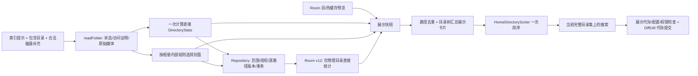

# 主页扫描、统计缓存与排序（2026-11-09）

## 工作区与边界

实施分支 `perf/home-gallery-sorting`；起始 HEAD `6246f6b156184035c19046225b8d6e2c50efac12`。
开始时仅 `buildSrc/build/` 未跟踪；保留该目录，未 reset、切换其他分支、推送、发布、修改签名或安装 APK。
祖先目录和项目中未发现适用的 AGENTS.md。

诊断材料 `/Users/patrick/Downloads/Gallery-Diagnostics-20261109-121442.txt` 仅用于核实旧行为：48 张卡片一次排序约 0.215 ms，期间仍有目录扫描。它不是修改后测量，也不能和主机测试拼成真机提升百分比。

本记录替代旧的“只做后台排序、不改扫描/schema”范围。旧记录保留为历史。

## 已修复的复现条件

| 条件 | 原行为 | 当前行为及证据 |
|---|---|---|
| A 修改/拍摄时间 `[1,100]`，B `[50,60]`，来回切换方向 | 缓存只有当前方向一个极值，另一个方向要重扫或排序错误 | 同时保存 min/max，升降序均 A、B；正式回归覆盖两种日期及反复切换 |
| 切换日期、大小排序 | 退役有效扫描，再枚举库、读元数据、更新缓存 | 只重建展示；缺字段的普通主页目录进入合并补齐队列；有效扫描保持同一 epoch |
| 未请求大小/日期、SAF 字段未知或日期查询失败 | 0/修改时间可能被当成完整新统计 | 独立 known 位；同范围未读字段保留旧预览值但保持不完整；不同范围不混用字段；缺失拍摄日期的已确认回退另计 fallback 数量 |
| 父目录自身有媒体，子孙更多/更新 | 展示数量和排序数量不同，日期/大小只反映父目录自身 | 从实际直接成员目录汇总，同一范围的计数、字节、两端日期和类型；合成父目录不再作为成员重复累加 |
| `/A` 与 `/AB`、Travel 与 travel | 前缀误归属或全局 lowercase 合并 | 目录分隔符边界；身份保留大小写；自然名称键仍可忽略大小写 |
| 包含目录经真实路径别名访问，目录有 `.nomedia` | canonical 校验可能把明确包含的同一目录误挡 | 包含/排除识别已解析别名，同时保留大小写和目录边界；符号链接测试与原有失败用例通过 |
| 合成父目录只有一个可导航后代、当前目录卡片 | 可能直接进入没有媒体的父目录，或取上一次批次的当前目录统计 | 无直接媒体的卡片继续分组导航；当前目录入口取本次直接统计，只展示自己的媒体 |
| 快速连续随机选择 | 旧 worker 可能在 clear 后写回新选择的 rank 表 | 每次有效选择使用独立并发 rank 表；同一次选择随扫描补全保持稳定，重新选随机会重排 |
| 物理文件已读到有效修改时间/大小，MediaStore 旧值不同 | 旧索引可覆盖刚读到的文件值 | 物理元数据优先；索引独有行、SAF/OTG 兼容分支保留；自定义拍摄日期仍优先 |

## 最终数据流和生产者



- `DirectoryStats` 为不可变值。`count` 是真实目录直接媒体数量，`bytes` 是同范围字节数；分别保存 min/max modified/taken、类型并集、known 位、范围版本、时间戳、拍摄时间回退成员数。真实 0 和未知不依赖数值区分。
- `FolderMediaReadResult` 分别携带 COMPLETE/PARTIAL/ACCESS_REQUIRED/FAILED、访问有效性和字段完整性；取消继续用取消异常传播。枚举成功不代表所有字段已知。
- `MediaFetcher.readFolder` 计算统计一次，`createDirectoryFromMedia` 复用结果处理名称/封面/兼容字段。普通主页、分类目录将准备好的 Directory 同时交给 Repository 和展示，避免二次完整统计和封面分组。
- 默认封面仍按相册内部排序/分组选首张可用媒体。有效自定义封面跳过相册媒体排序和分组。媒体网格/Viewer 所需的排序保留，比较器语义未改。
- 物理目录写入统一进入 `DirectoryMetadataRepository`；MediaActivity 的原始完整扫描、延迟重试、启动接收器、新照片任务和直接更新入口遵循相同门控。选择器/局部过滤/受保护而未授权的范围不能回写公共完整统计。
- 分类目录的统计只有与公共范围一致才可写公共缓存；部分/不可访问结果保留预览。收藏目录页拥有自己的清单、认证和加载代际，排序不再强制重载清单或扫描；范围/授权失效会清除旧卡片并明确终止加载，避免刷新状态悬挂；它不以收藏子集覆盖普通相册统计。
- `updateDirectories` 只将卡片名称/封面/状态合并回直接目录集，不回灌汇总计数、大小或日期，也不批量 REPLACE/失效无关行；实际重命名 DAO 使对应统计失效。旧 `updateDBDirectory` 限于虚拟收藏/回收站兼容数据。
- 相同统计的读取不会仅因 scannedAt 改变而重新写目录行/通知观察者；DiffUtil 也忽略这个非展示时间戳。scannedAt 表示最近一次**持久化且有变化**的扫描，不是每次验证的时间。

## Room v11 → v12

新增 `directories.stats_*` 嵌入列，使用 ALTER TABLE，所有其他表及旧列保持。没有删库、重建用户数据或 destructive migration。
DAO 的目录 SELECT 改为读完整行（含 id 和统计）；物理统计用保留 id 的 UPDATE。旧兼容字段 modified/taken 映射为最大有效时间，方向选择与日期滚动气泡均由统计两端决定。

旧行 `stats_known=0`、`stats_scope=''`：可以首屏预览，但不会把原来的一个极值复制成两个并声称完整。正常扫描后台补齐；已有完整数据的排序切换不做数据库读写。完整枚举但字段不完整时只接受可确认字段，并保留待补齐/部分状态。

正式迁移测试从冻结的完整 v11 表结构和有数据的所有表开始，由真实 Room 执行升级和 schema 校验，核对目录 id/封面/旧时间/大小/旧 sort_value、媒体、收藏、收藏目录、自定义日期、widgets 均保留。保护、封面配置、自定义顺序等 SharedPreferences 没有迁移写入。未知更旧/更新的版本继续失败关闭，保护原数据。

## 何时排序，何时扫描

| 操作 | 工作范围 |
|---|---|
| 完整且同范围的名称/路径/数量/大小/日期/自定义/随机及方向切换 | 相册级快照、必要分组、排序、搜索和 DiffUtil；媒体枚举/查询/元数据/DB 增量为 0 |
| 扫描中切换排序 | 扫描不取消，新批次按最新展示配置准备；旧展示代际丢弃 |
| 普通主页已有目录缺少当前排序字段 | 合并到单个有界重试 worker，读取该目录全部统计字段一次；最新已提交统计可满足界面尚未回绑的重复请求；失败冷却后由外部事件再唤醒 |
| 收藏/分类数据尚未完成 | 保留可用清单，由同一正在执行的加载任务补齐；失败仍为失败/部分状态，通过原刷新入口重试 |
| MediaActivity/后台任务报告一个目录改变 | 该目录的版本门控统计回写 + 元数据观察者重绑，不启动主页全库扫描 |
| 权限、过滤范围、隐藏/包含/排除改变；手动刷新；无法定位的库变更 | 按新的数据范围失效，保留授权/取消检查，允许受控扩大到库扫描与未索引发现 |

没有增加逐文件 EXIF 深度扫描；旧的 custom > indexed > modified 拍摄日期回退被保留，并明确记录回退数量。索引和磁盘需要同时保留，不能以索引非空证明 `.nomedia`、未索引或受限目录完整。

## 并发与安全

保留扫描 epoch、展示 generation、取消信号、逐路径 Repository version、适配器 diff generation、滚动/操作期间延迟提交和一次终结回调。
新增的数据/授权快照与排序/搜索配置分开：提交检查权限、持久授权、保护配置和数据过滤范围。该检查不进入逐文件取消轮询，避免为每个媒体重复查询授权状态。

Repository 在计算前、锁内和事务内复核授权/范围；失败、不完整枚举、锁定目录不能产生“真实空目录”证据。公共缓存不接受选择器范围。分组聚合只在展示副本上进行，使用实际直接统计逐祖先累加；合成目录不写回。

## 测试与测量

环境：macOS Darwin arm64；Android Studio 自带 JBR/OpenJDK **25.0.3**；Gradle **9.5.1**；SDK `/Users/patrick/Library/Android/sdk`；使用本机离线依赖。测试编译目标由项目配置决定，不把实际运行 JDK 写成 17。

```sh
ANDROID_HOME=/Users/patrick/Library/Android/sdk \
JAVA_HOME='/Applications/Android Studio.app/Contents/jbr/Contents/Home' \
./gradlew :app:testFossReleaseUnitTest --offline
```

先执行针对性测试，再执行完整 Release 单测。最终完整测试 **1088 项通过，0 失败、0 错误、0 跳过**，BUILD SUCCESSFUL in 1m 43s。针对性主流程 61 项通过，另有日期气泡、收藏终止边界与目录变更/适配器 36 项专项回归。命令、日志、原始主机测量在 [validation-2026-11-09](validation-2026-11-09/) 中。

第一轮完整回归是 1081 项、15 失败；已保留原日志。处理了 v12 已成为当前 schema 的版本边界测试、异步准备等待、物理元数据覆盖陈旧索引的旧断言。macOS 默认 `/var` 与 `/private/var` 使多项符号链接保护夹具错误比较不同路径，Gradle 仅将**测试 JVM 临时根**规范化为 canonical 路径；没有放松保护判断或删除安全断言。目录适配器回归夹具另显式安装/恢复 Picasso，消除了单独运行时对其他测试初始化顺序的依赖。基线副本也复现了相关既有异步/路径失败。

正式新增/扩展测试包含双向日期缓存、分组直接成员/无成员/多层/当前入口、大小写和确认别名、未知与真实 0、部分字段保留、迁移所有表、授权及旧请求拒绝、补齐合并、真实 MainActivity 快速选择/数据库回写/适配器提交、默认和自定义封面。

### 同数据集对照

`HomeSortingComparisonBenchmarkTest` 可复制到起始 HEAD，在 `/tmp` 解包的基线运行；没有切换原分支。两版使用相同实际排序对话框、等待 Handler 回调和适配器完成、同样 3 个相册/360 个未索引 JPEG/明确包含的 `.nomedia` 目录。

基线每次日期/方向切换额外发生 **7 次 provider 查询、5 次目录枚举、360 次元数据读取、7 次媒体排序（输入共 360）、22 条 Room SELECT、363 条 Room 修改语句**；首次大小切换观察到 8 次 provider 查询。修改后这些切换的上述增量均为 **0**。名称和数量两版本来就无需媒体扫描。分组后的展示也不新增扫描。

单独工作量测试还覆盖连续 20 次快速选择和被阻塞扫描期间的选择，断言 fetcher 与扫描 epoch 未变、六类外部工作计数不变；一个相册新增文件后，确认另外两行统计完全不变，仅 1 行相册统计写入，主页扫描不重启。

主机单次观测（毫秒，顺序/JIT 未做配对控制，仅报告原值）：

| 操作 | 起始 HEAD | 修改后一次完整套件观测 |
|---|---:|---:|
| 首次可用相册列表 | 400.07 | 113.59 |
| 完整统计准备（含回调排空窗口） | 519.50 | 259.28 |
| 修改时间升序：对话框→提交 | 231.27 | 28.64 |
| 修改时间降序：对话框→提交 | 248.28 | 36.62 |
| 拍摄时间升序：对话框→提交 | 211.09 | 45.82 |
| 拍摄时间降序：对话框→提交 | 260.72 | 48.10 |
| 大小：对话框→提交 | 580.97 | 58.32 |
| 开启子目录分组→提交 | 19.73 | 23.72 |

耗时表对应最终 1088 项通过的完整套件测量。跨运行差异不作为性能比例结论；稳定的证据是日期/大小切换的媒体工作和数据库工作消失。

原始耗时同时保留，但只是主机单次观测：测试启动/JIT/模拟时钟/诊断日志/对话框渲染均会影响结果。冷测 fullStats 指标包含明确的约 100 ms 回调排空窗口；人工阻塞测试的扫描计时在解除阻塞后开始。不能据此推导 Android 真机提升百分比。

### 指标覆盖和限制

| 指标 | 记录方式/限制 |
|---|---|
| 首次可用列表、完整统计准备、排序到提交 | 主机比较测试分别记录；真机未验证 |
| MediaStore 查询/行数 | fixture provider 全部查询次数；此未索引数据集行数为 0；运行时 source summary 有查询和行数计数，但不涵盖所有旧发现查询 |
| 目录枚举/文件元数据 | `FolderFileAccess` 包装计数 + source summary；目录发现遍历另有日志，不把没有埋点的工作说成 0 |
| 媒体排序次数/输入 | `MediaFetcher.sortMedia` 计数；基线 `sortValue.sortedBy` 额外排序不在该计数内 |
| 统计计算 | `directoryStatsCount`，每次 readFolder 一次；基线无同口径计数，未提供虚构的前值 |
| 数据库读取/写入 | 比较测试 Room QueryCallback 统计 SELECT/修改语句；热切换 SQL 增量为 0，因此读取/修改行数增量也为 0；冷扫描非零语句数不能冒充返回行数或实际受影响行数。360 媒体、3 目录的 fixture 数据量已独立核对 |
| 相册排序、分组、DiffUtil | 已有 `album_sort_key_prepare`、`album_presentation_sort`、`album_group_sort`、`album_presentation_filter`、`album_diff_calculate/commit` 诊断阶段；主机测试有总提交时间；真实设备分阶段前后对照未验证 |
| 单相册变更 | 实测 provider 查询增量和 1 行目录更新；此后台入口的逐文件读取和枚举细分未额外埋点，未把它们记为 0 |

## 兼容性风险与真机验收（未验证）

本轮没有进行设备安装或真机交互验收，也没有宣称绝对无回归。

1. 在 v11 有真实收藏、保护配置、自定义日期/封面/顺序和 widgets 的数据库副本升级，核对所有数据及首屏预览→补齐过程。
2. 分别在旧存储权限、Android 11+ 全文件访问、分区存储、部分照片授权、SAF 持久树、OTG/断开外置存储下测试；测试中撤销权限和重新加锁，确认迟到结果不显示、不写回。
3. 使用含未索引、`.nomedia`、隐藏/排除/包含、多层和大小写目录、所有类型过滤的相同媒体集，独立核对目录总数、计数、字节和两端时间。默认/自定义封面及子目录导航返回要单独检查。
4. 冷启动、热返回、方向切换、快速选择、搜索/滚动/布局切换/后台回写同时发生，读取同一诊断窗口的扫描/查询/元数据/DB/分组/差分计数和首屏/最终提交耗时。
5. 实测重命名/移动/删除/新增、收藏/置顶/回收站位置、系统选择器、第三方 Intent、PhotoProfile、媒体网格和 Viewer。完整主机单测覆盖部分路径，不等同这些设备边界已通过。

较大的分类树仍需实际设备确认：聚合按目录祖先索引进行，创建共享父目录需处理层级，首次完整扫描仍保留必要的默认封面排序和合法磁盘补充。MediaStore 与物理时间差异会使先前按陈旧索引显示的顺序发生正确更新，这是预期的数据来源修复。
